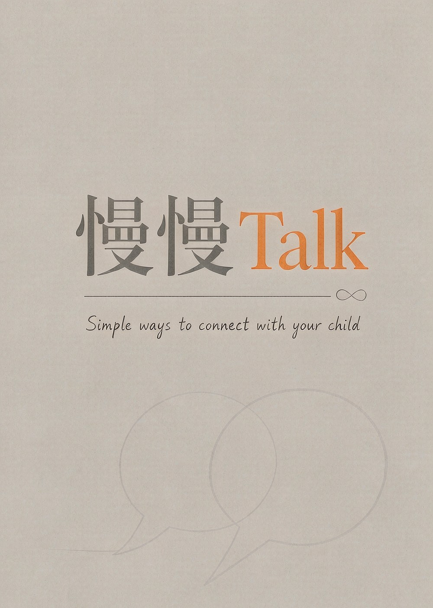

<!-- README 说明：面向使用者的介绍，含能力表与边界声明 -->

<p align="center">
  <a href="./assets/cover.jpg">
    
  </a>
</p>

<h1 align="center">慢慢Talk · manmantalk</h1>

<p align="center">
  <strong>不替你教育孩子，陪你看清刚才发生了什么、下次可以怎么说。</strong>
</p>

<p align="center">
  面向父母、祖父母及其他亲属与老师的亲子沟通教练，<br>
  把依恋理论、非暴力沟通、正面管教等育儿体系，<br>
  转译成具体、尊重、不操控、可以直接照说的沟通能力。
</p>

很多亲子沟通的建议只有两个答案：「多陪陪孩子」或「你别管太严」。慢慢Talk 不下一句结论就完事：它先把刚才那段话里谁说了什么、在哪一句转折摆出来，再把事实、推测和未知拆开，然后给出下次可以直接照说的句子，连孩子可能有哪几种反应、分别怎么接一起给。

它不是话术库。它先让你看见这次真实发生了什么，方法放在后半段，而且必须是能执行的句子，不是「你应该多共情」这种空话。

## 什么情况下可以找它

| 你的情况 | 它可以做什么 |
| --- | --- |
| 刚跟孩子吵完，心里过不去 | 逐句复盘谁的哪句话让事情发生了转折；两边都给证据 |
| 不知道下次这句话怎么说 | 先给一条可以直接照说的成品，再写说的时机和孩子可能的反应 |
| 写作业、手机、睡觉，规则定了执行不下去 | 先看是哪一种失败，再给切分做法 |
| 孩子沉默、回避、不愿说 | 先分清是暂时不想说还是长期不说，分别给做法 |
| 想聊性教育、身体、爱、死亡、恋爱却开不了口 | 按学段给说法，守住「给事实不给判决」 |
| 离异、单亲、丧亲、重组，不知道怎么跟孩子讲 | 按顺序说，把大人的事和孩子的事分开 |
| 孩子被孤立、被欺凌，或你自己是老师 | 家长视角和老师视角分开处理 |
| 你自己很累、自责、没信心 | 先分清是「想错了」还是「撑不住了」，给当天能做的动作 |
| **希望以后不用重复交代背景** | **长期记忆**：首次明确同意后，跨任务记住有限的结构字段；可随时查看、暂停、撤销、删除 |

## 录音转写：默认在本机，也可以走云端

上传录音后，Skill 会先把它转成逐字稿再分析。**默认路径完全在本机离线完成**：不上传、不需要账号或密钥、不花钱。

如果你想要**说话人编号**（能分出「这段话是另一个人说的」），可以自己配一个腾讯云的密钥，脚本检测到就会自动改走云端：

```
TENCENTCLOUD_SECRET_ID=你的SecretId
TENCENTCLOUD_SECRET_KEY=你的SecretKey
```

| | 本机（默认） | 腾讯云（自配密钥后） |
| --- | --- | --- |
| 录音去哪 | 留在本机 | **上传到腾讯云处理** |

**脚本会联网的地方只有两处**，写在这里备查：① 启用云端时，向腾讯云语音识别 `asr.tencentcloudapi.com` 上传音频；② 首次用本机转写时，从 `hf-mirror.com`（Hugging Face 国内镜像）下载模型。除此之外不联网、不上传。
| 说话人编号 | 没有 | 有 |
| 费用 | 无 | 按量计费 |
| 需要装什么 | `pip install faster-whisper`（首次下载模型约 500MB） | 不需要 |

想强制不上传，任何一次都可以加 `--provider local`。详细开关、地域、费用与排错见 [`references/转写升级路径.md`](references/转写升级路径.md)。

**两件要知道的事**：① 录音里是孩子的声音，启用云端前请确认已取得监护人同意；② 腾讯云单次直传上限 5MB，脚本会自动压缩、尽量一次传完，实在放不下才切成几段——**切成几段时，各段的说话人编号互不可比**，逐字稿里会标出切片位置。

## 输入与证据边界

- **录音文件**：转写里的说话人编号只是声学聚类，不是角色；本机转写甚至不产生这个字段。进入分析前必须先做一次角色确认，确认前不下任何结论；被切片时还要确认跨片的是不是同一个人。
- **聊天截图、导出或粘贴记录**：只把可见原文、说话人、顺序、间隔和表情当事实，不补线下动作、语气或内心。
- **用户转述**：视为使用者提供的信息；精确措辞不可核实时注明。
- **只根据回忆时**：不做逐句证据，改按事件顺序和反复出现的模式梳理，并说明依据是回忆而不是原话。**也不给分数和等级**——那套判据（五个维度、卡点、S–D 等级）要有录音转写或截图原文才用得上。

## 会问几轮，什么时候结束

分析最多 6 轮（目标 5 轮），追问全程不超过 5 个问题——首轮最多 2 个，之后每轮最多 1 个。第一次给分析时就会说清这次大概几轮、最多几轮，你心里有底，不会没完没了。问到该问的就会停下，不会一直追着你要答案。**追问都是开放题，你自己打字回答**——不会给你一串猜好的选项让你挑；只有第一次建档那几项是点选。

到点由它主动收尾，不再提问，并给一份整体说明：完整链条、你做对的地方、最要紧的 1–2 处要改、下次直接说的话、仍不确定的部分、接下来看什么。想更深入也可以直接说「再问几个」——上限是替你设的，不是替它设的；你没说具体几个时它心里有数，问完会停。

出现自伤、被欺凌这类信号时，这个上限自动失效：先给求助渠道，其余往后放。

资料彼此矛盾时指出矛盾；缺失信息保持未知，不为了完整而虚构。

## 长期记忆只存结构，不存原话

默认**不开启**。首次明确同意后才启用，并且：

- **只存**关系类型、孩子的年龄与学段、孩子生理性别、孩子的青春期状态、长辈的年龄性别与教育理念、长辈自评、出现过的场景标签；另有**历次等级**，它只在有录音转写或截图原文的分析里才会产生——只根据回忆时不给等级，也就不会写这一项。
- **不存**任何原话、逐字稿片段、录音，以及姓名、学校、生日等可识别信息。字段名里出现这类词会被直接拒绝写入。
- 每次更新都提示变更和撤销方式；可查看、暂停、撤销或删除，不无限累积。

要分清楚：上面这些是**可以存**的字段，不是第一次就要你填的题。**首次建档只问六个小问题**——孩子的年龄和性别、你的年龄和与孩子的关系、最近一个月关系怎么样、这次你想从哪儿说起。其余的（学段、青春期、家里怎么做、孩子平时是说还是闷着）**用到哪一项才问哪一项**，不堆在第一屏。学段也不用你答，按年龄换算。

## 安全边界

- 不诊断心理疾病，不用标签替代行为证据，不给未成年人贴任何人格标签。
- 不对未成年人做任何测评或评估。长辈自评只作为使用者自己的参照，不与常模比较、不与诊断标准挂钩。
- 使用者是老师或非监护人亲属时，上传前需先获得孩子监护人的同意；**启用云端转写同样需要先取得同意**，因为那意味着录音要离开本机。
- 出现自伤、自杀、被欺凌、被不当触碰、使用者动手致伤或持续「活着没意思」这类信号时，暂停常规报告，先给求助渠道。
- 遇到正在发生的人身危险，先确认当下安全并联系当地紧急服务。

**这不是诊断，也不替代专业帮助。**

## 目录结构

```
SKILL.md                      # 主入口：frontmatter（发布用 slug／displayName／summary／tags／license ＋安装用名称／显示名／双语简介）＋核心原则、每次分析流程、录音处理、按需加载路由表、安全边界
README.md
LICENSE                       # PolyForm Noncommercial 1.0.0（仅限非商业使用）
requirements.txt              # 可选依赖说明（只有「处理录音」这条路需要）
.gitignore                    # Git 忽略规则：缓存、转写产物、模型、音频、打包件
.gitattributes                # 固化换行符规范，避免跨系统出现整文件伪 diff
CHANGELOG.md                  # 版本变更记录
CONTRIBUTING.md               # 贡献指南：怎么反馈问题、怎么提改动
assets/
  cover.jpg                   # 本 README 的头图
  app-icon-512.png            # 512×512 PNG，技能市场提交用的图标
  app-cover-1280x720.png      # 1280×720 PNG，技能市场提交用的封面
references/
  00-导读与使用分级.md          # 两套分级（证据分级、使用分级）与使用说明
  转写升级路径.md               # 可选：换别的云端、更强的模型，或改用 MCP 转写时读
  knowledge/                  # 机制层：为什么会这样、怎么判断、边界在哪
    01-判断标准.md
    02-学段差异.md
    03-依恋与情绪机制.md
    04-家庭系统与教养方式.md
    05-常见误区与心理教育.md
    06-孩子的表达方式与信号.md
    07-法律与权利边界.md
    08-危机识别与求助渠道.md
  practical/                  # 做法层：这一步该怎么做
    01-开口与演练.md
    02-当场校准.md
    03-事后修复.md
    04-日常冲突与规则.md
    05-沉默与回避.md
    06-敏感话题与成长命题.md
    07-家庭结构与变故.md
    08-校园与师生.md
    09-长辈自我照顾.md
    10-长期记忆与亲子档案.md
scripts/
  transcribe.py               # 转写：默认本机离线；配置腾讯云密钥后自动改走云端
  memory_store.py             # 本地、有界、需同意的长期记忆存储
examples/                     # 用法示例：建档／口述／录音三种流程（随包分发，不进运行时）
documentation/                # 项目文档：产品定位、架构、流程、权限与变量（随包分发，不进运行时）
```

参考分两层：`references/knowledge/` 是机制与依据，`references/practical/` 是做法。默认只读取当前问题直接需要的 1–3 份，不批量加载整套参考。

`documentation/` 面向维护者，记录产品定位、架构与信任边界、关键流程、知识库治理、权限与自动化边界、变量与配置。**它随包分发**——上架包里带着，方便你和别人查看、改进；**但不进入运行时**：宿主安装同步只取 `SKILL.md`、`references/`、`scripts/` 和 `assets/`，所以装到别人机器上不会有它，也不影响使用。真正跑起来只需要前面那几类文件。

## 转写脚本用法

```bash
python scripts/transcribe.py "录音.wav" --out ./output          # 默认：有密钥走云端，没有走本机
python scripts/transcribe.py "录音.wav" --provider local        # 强制本机，绝不上传
python scripts/transcribe.py "录音.wav" --codec mp3             # 编码格式（默认 opus）
python scripts/transcribe.py "录音.wav" --dump-raw              # 存下云端原始响应，便于排错
```

产出 `<out>/<文件名>.jsonl`（结构化）与 `<out>/<文件名>.md`（可读逐字稿）。转写中间文件用后即删。

## 长期记忆脚本用法

```bash
python scripts/memory_store.py status                    # 查看状态
python scripts/memory_store.py enable --confirm          # 使用者明确同意后启用
python scripts/memory_store.py apply --json '{...}'      # 写入一个字段
python scripts/memory_store.py context --subject-id guardian   # 按需召回
python scripts/memory_store.py pause / resume            # 暂停 / 继续
python scripts/memory_store.py undo                      # 撤销上一次更新
python scripts/memory_store.py revoke --delete --confirm # 撤回同意并删除
```

数据默认保存在本机用户目录（可用环境变量 `MANMANTALK_MEMORY_DIR` 覆盖，旧名 `MENTALXTALK_MEMORY_DIR` 仍兼容），不联网、不上传。

## 许可：仅限非商业使用

本项目以 **PolyForm Noncommercial License 1.0.0** 发布，**仅限非商业使用**；这条对**任何获取渠道**都生效，包括从技能市场下载安装之后。条款要点与 `LICENSE` 正文一致：

| | 条款 |
| --- | --- |
| 可以 | 个人、家庭、教育、公益、研究等**非商业目的**：使用、复制、修改、合并、发布、分发，含衍生版本；用于与自己家人、学生或服务对象的沟通实践 |
| 不可以 | **任何商业目的**——出售本项目或衍生版本；作为付费产品／课程／咨询／社群的组成部分；用于获客、导流、增值或以其他方式换取商业利益；**在商业机构内部用于对外经营业务** |
| 必须 | 保留本许可与版权声明，不得移除或修改；分发时须随附这些条款 |
| 商用 | 须事先取得版权持有人的**另行书面授权** |

`LICENSE` 为中英对照版本，**如中文说明与英文条款冲突，以英文条款为准**；完整条款见 `LICENSE`。
